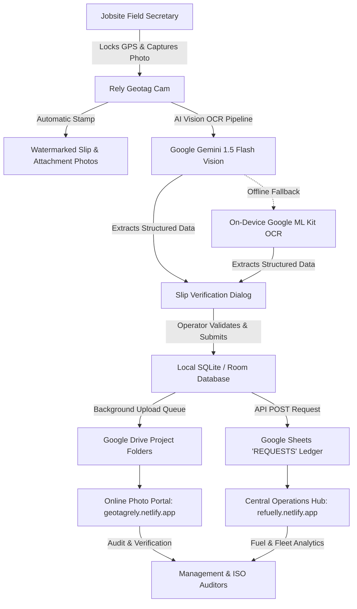

# Rely Geotag Cam & Smart ATW Slip Scanner

[](https://developer.android.com/)
[](https://kotlinlang.org/)
[-4285F4?logo=jetpackcompose&logoColor=white)](https://developer.android.com/jetpack/compose)
[](https://ai.google.dev/)
[](https://developers.google.com/ml-kit)
[](#iso-9001-compliance--audit-trail)

An enterprise-grade Android application developed for **Rely Construction & Supply, Inc.** Designed specifically for jobsite Project Secretaries, Field Clerks, and Fuel Dispatchers to automate fuel issuance tracking, equipment telemetry logging, and document auditing with tamper-evident GPS watermarking and AI-powered optical character recognition.

---

## 🏗️ Ecosystem & Process Flow



### Complete End-to-End Workflow:
1. **Field Capture**: The Project Secretary captures an image of the physical **Authority to Withdraw (WHSE05)** slip using the app. The shutter is locked until the device obtains a verified GPS fix.
2. **AI Document Processing**: The image is analyzed by **Google Gemini Vision API** (or on-device **Google ML Kit** if offline) to parse handwritten and stamped slip fields.
3. **Operator Validation**: The structured data is presented in an interactive Material 3 dialog for quick operator confirmation with fuzzy-matched dropdowns.
4. **Permanent Watermarking**: Coordinates, timestamp, compass bearing, jobsite address, and equipment identifiers are burned directly into the JPEG pixels.
5. **Multi-Document Attachments**: Supporting documents (pump meter readings, invoices, equipment tags) are captured and linked directly to the parent ATW slip.
6. **Automated Cloud Sync**: Watermarked images are sorted into designated project folders on **Google Drive**, while structured records populate the centralized **Google Sheets** `[REQUESTS]` ledger.
7. **Cloud Verification & Analytics**:
   - **Document Viewer**: [`https://geotagrely.netlify.app/requests?atw=<ATW#>`](https://geotagrely.netlify.app) allows one-tap visual inspection of all slips and supporting attachments.
   - **Operations Hub**: [`https://refuelly.netlify.app/`](https://refuelly.netlify.app) provides real-time fleet fuel consumption metrics, cost-center allocation, and variance reporting.

---

## ✨ Key Features

### 1. 📍 Enforced GPS Geotagging & Tamper-Evident Watermarking
- **Capture Guard**: Shutter remains disabled until satellite GPS synchronization is confirmed, preventing unverified or simulated captures.
- **Burned-in Overlays**: Embeds latitude, longitude, altitude, compass azimuth, reverse-geocoded physical address, timestamp, project name, and equipment identifiers directly into the bitmap.
- **Custom Branding**: Supports uploading and watermarking custom corporate logos.

### 2. 🤖 Hybrid Multimodal AI Vision OCR
- **Google Gemini 1.5 Flash Vision**: Server-side multimodal visual reasoning with automated model cascading (`gemini-1.5-flash`, `gemini-flash-latest`, `gemini-2.5-flash`, `gemini-2.5-flash-lite`).
- **On-Device ML Kit Fallback**: Zero-network fallback with localized zone contrast enhancement and red-ink mask isolation.
- **Domain-Specific Spatial Parsing**:
  - **CTRL NO**: High-precision detection of red-ink stamped control numbers (e.g., `204855`, `196571`).
  - **Project Name**: Normalized against 43+ official master project records (e.g., `Pl63 Landfill` $\rightarrow$ `P163 LANDFILL`, `Laverna Outfall` $\rightarrow$ `P194 LAVERNA OUTFALL`).
  - **PMS / Plate #**: Unit-level equipment recognition with OCR look-alike correction (e.g., `8H163` or `BHl63` $\rightarrow$ `BH 163 - SANY 215H`).
  - **Quantity & UOM**: Isolates fuel volumes (e.g., `280.0 LTRS`) from the item description.
  - **Odometer / Hour Meter Range**: Distinguishes running ranges (e.g., `3943.37 - 3953`) into separate Start and End database columns.
  - **Strict Remarks Isolation**: Geometrically isolates handwritten work descriptions (`Assist laying boulders for gabions`) strictly above the signature divider, ensuring requester and approver names are never corrupted into work notes.
  - **Date Normalization**: Standardizes diverse handwriting formats (`11-03-26`, `11.3.2026`, `11/03/2026`) into uniform `M/D/YYYY`.

### 3. 📎 Multi-Attachment Document Scanner
- Integrates Google Play Services Document Scanner for rapid capture of supporting meter photos and receipts.
- Automatically indexes attachments (`#1`, `#2`, etc.) and links them to the primary ATW control number.

### 4. 📴 Offline-First Resilience
- Built with **Android Room Database** to queue photos and records locally on the device.
- Upload worker automatically resumes transfers when network connectivity is re-established.
- Manual retry triggers and real-time upload status indicators (`🟢 UPLOADED`, `🟡 PENDING`, `⏳ UPLOADING`, `🔴 FAILED`).

### 5. 🔍 Built-in Audit Gallery & Portal Deep Linking
- In-app media gallery supporting high-resolution image zoom and video playback.
- **One-Tap Netlify Link**: When viewing any ATW slip or supporting attachment in the gallery, the app renders an interactive **"View Online"** button opening `https://geotagrely.netlify.app/requests?atw=<ATW#>` in the browser.

---

## 🛠️ Technology Stack

| Layer | Technologies |
|---|---|
| **Language** | Kotlin 2.0+ (100% Coroutines & Flow) |
| **UI Framework** | Jetpack Compose, Material Design 3 (M3) |
| **Camera & Video** | Android CameraX, Media3 ExoPlayer |
| **Vision & OCR** | Google Generative AI (Gemini 1.5 Flash REST API), Google ML Kit Text Recognition |
| **Location & Hardware** | Google Play Services Location API, Android Sensors (Compass/Azimuth) |
| **Local Storage** | Android Room Database (SQLite), Android MediaStore API |
| **Networking** | OkHttp 4, Retrofit 2, Moshi |
| **Image Loading** | Coil Compose |
| **Cloud Storage** | Google Drive API, Google Apps Script Web App (Sheets Integration) |
| **Web Infrastructure** | Netlify (`geotagrely.netlify.app`, `refuelly.netlify.app`) |

---

## 🚀 Getting Started

### Prerequisites
- Android Studio Ladybug / Meerkat or newer
- Android SDK 34+ (Minimum Supported SDK: 23 / Android 6.0 Marshmallow)
- Google Cloud / AI Studio API Key with Generative Language API enabled
- Configured Google Apps Script Web App URL for Google Sheets logging

### Configuration & Environment Setup

1. **Clone the Repository**:
   ```bash
   git clone https://github.com/your-organization/rely-geotag-cam.git
   cd rely-geotag-cam
   ```

2. **Configure Environment Secrets**:
   Create a `.env` file in the root project directory (or configure via the AI Studio Secrets panel):
   ```properties
   # Google AI Studio / Gemini API Key
   GEMINI_API_KEY=your_gemini_api_key_here

   # Target Google Apps Script Web App Deployment URL
   GOOGLE_SCRIPT_WEB_APP_URL=https://script.google.com/macros/s/your_deployment_id/exec
   ```

3. **Google Services Configuration**:
   Ensure `app/google-services.json` is present if utilizing Google Sign-In or Play Services authentication.

4. **Build & Install**:
   ```bash
   # Assemble Debug APK
   ./gradlew assembleDebug

   # Run Local JVM Unit & Robolectric Tests
   ./gradlew testDebugUnitTest
   ```

---

## 📂 Project Structure

```
app/src/main/java/com/example/
├── MainActivity.kt                     # Camera view, GPS HUD, and main capture workflow
├── SlipOcrScanner.kt                   # Gemini Vision API & on-device ML Kit OCR engine
├── WithdrawalSlipEntryDialog.kt        # M3 slip data review dialog with fuzzy search
├── GalleryScreen.kt                    # Gallery viewer, media player & Netlify portal integration
├── WatermarkManager.kt                 # Pixel-level geographic and metadata canvas renderer
├── UploadManager.kt                    # Background upload coordination & status management
├── DriveUploadHelper.kt                # Google Drive OAuth and file creation utilities
├── SheetDataManager.kt                # Google Sheets synchronization and datalist cache
├── AppDatabase.kt                      # Room database definition for pending uploads
├── PendingUpload.kt                    # Entity representing queued photo and slip records
├── ProjectList.kt                      # Master catalog of 43+ official company jobsites
└── EquipmentList.kt                    # Master catalog of heavy equipment and fleet assets
```

---

## 📋 ISO 9001 Compliance & Audit Trail

This application supports strict **ISO 9001:2015 Quality Management System** compliance for civil engineering construction and supply:

- **Section 7.5 (Documented Information)**: Standardized naming convention (`ATW_[CTRL#]_[PROJECT]_[EQUIPMENT]_[TIMESTAMP].jpg`) and permanent pixel watermarks ensure records cannot be retroactively altered or forged.
- **Section 8.4 (Control of Externally Provided Processes, Products and Services)**: Unambiguous verification of fuel volume delivered per equipment hour meter reading ensures vendor accountability.
- **Section 8.5.2 (Identification and Traceability)**: Every liter of fuel logged in the `[REQUESTS]` ledger links directly to the visual proof of issuance on `geotagrely.netlify.app`.

---

## 🔒 Security Notice

- **API Credentials**: API keys and service secrets must be configured via secure environment variables or Android `BuildConfig`. Never commit active production keys to public version control.
- **Access Control**: Production Google Drive upload folders and Google Sheets should be restricted to authenticated corporate service accounts.

---

## 📄 License & Ownership

Copyright © 2024–2026 **Rely Construction & Supply, Inc.** All rights reserved.  
Internal proprietary software developed for fleet logistics, equipment maintenance, and material issuance management.
